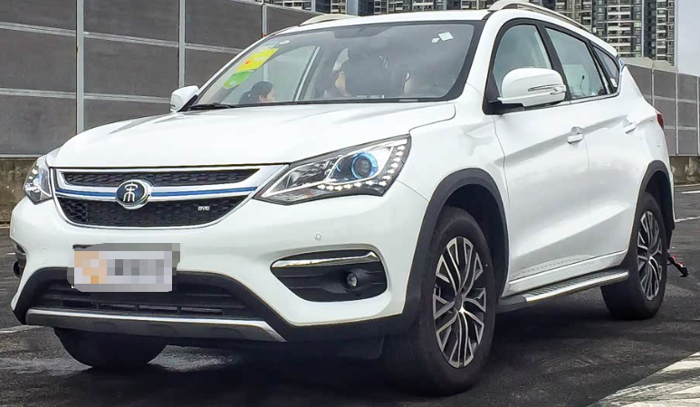

# DiPlay API 17 兼容性移植

本仓库是基于 [shihabal3amri/DiPlay](https://github.com/shihabal3amri/DiPlay) 的 Android API 17 有线和无线 CarPlay 移植，项目代码遵循 GPL-3.0。公开源码和版本 APK 发布在 GitHub Releases。

## 开机自动连接，无需 VPN 授权

**本项目在应用内处理 CarPlay 所需的通信。有线和无线版都无需建立 Android 系统 VPN，车机重启后也不会再出现 VPN 授权弹窗。**

- **有线插线即连。** 应用内的 lwIP 协议栈直接处理 USB NCM 链路上的 IPv6、TCP 和 UDP，投屏会话走应用内套接字。开启自动连接并完成首次授权后，车机开机即可检测 iPhone，插上数据线就自动进入投屏。
- **无线上车自动连接。** 应用内的 USB 蓝牙协议栈负责外置适配器的配对，并通过 iAP2 引导 iPhone 加入车机建立的 Wi-Fi Direct 局域网。画面、声音和控制直接走 Wi-Fi。首次配对并成功投屏后，保持适配器插着、iPhone 的蓝牙和 Wi-Fi 开启，车机开机就会自动尝试连接。

初次使用请按系统提示完成 USB 访问授权和 iPhone 端确认。无线版在支持 Wi-Fi Direct 的 MX9A0 车机上默认使用该模式。请关闭车机系统热点，车机移动数据可以保持开启。

## 下载 DiPlay

| 版本 | 下载 | 连接与安装 |
| --- | --- | --- |
| **有线 CarPlay 0.44.52** | [**下载有线 APK**](https://github.com/hange3514/DiPlay-API17/releases/download/v0.44.52/DiPlay_API17_0.44.52.apk) | USB 数据线连接 iPhone，支持最高 60 FPS 配置与双指触控转发。[版本说明](https://github.com/hange3514/DiPlay-API17/releases/tag/v0.44.52) |
| **无线 CarPlay 0.1.117** | [**下载无线 APK**](https://github.com/hange3514/DiPlay-API17/releases/download/wireless-v0.1.117/DiPlay_API17_0.1.117-auto-evidence.apk) | 实车使用绿联 CM591（`10D7:B012`），iPhone 自动加入车机的 Wi-Fi Direct 局域网。默认 20 FPS，可调至 60 FPS。[版本说明](https://github.com/hange3514/DiPlay-API17/releases/tag/wireless-v0.1.117) |

**反馈只填问题。** 两版都会自动把可读取的原厂车型代码、固件版本、ALSA 声卡与采集路径、通话诊断和方向盘事件放进同一份报告。停车复现问题后，在车机里写一句现象并提交即可。 [反馈与隐私](docs/COMPATIBILITY_TESTING.md)

## 适配交流

**QQ群「就是耍」 · `1078069411`**。用 QQ 扫下方二维码，或搜索群号加入。

欢迎其他车型用户在群里交流。遇到通话无声或方向盘按键异常，可在车机复现后提交问题描述。我有时间会根据收到的诊断排查适配。

## 实测车型

有线和无线版目前都只在下图这台 **2018 款比亚迪宋 DM** 上实测。车机为 Freescale MX9A0、Android 4.2.2 / API 17、1024 × 600，手机为 iPhone 15 Pro Max / iOS 26.2.1。无线版实测使用绿联 CM591，CM390 代码参考上游项目，尚未实车测试。

## 更正与致歉

我此前把自己的车辆年款误写为 2017 款。经重新确认，实际测试车辆是 **2018 款比亚迪宋 DM**。此前错误说明可能误导读者，我为此郑重致歉，相关车型信息现已同步更正。

## 0.44.50 更新摘要

- 修复方向盘上一曲、下一曲间歇失效。投屏显示首帧后申请媒体键接收权，断开后释放。
- 增加媒体键接收权回读、收键和转发的诊断记录。
- 延续 0.44.49 的免 VPN 有线连接、麦克风降噪、界面和连接预热。

安装步骤与文件校验见 [0.44.50 发布说明](docs/RELEASE_0.44.50.md)。

## 隐私与发布内容

兼容性报告会上传到维护者的私人服务器。报告可能包含车机型号及 Android 版本、用户描述、USB 接口特征、按键码、连接阶段日志和用户手动确认的测试结果。介意上传到私人服务器的用户请勿提交报告。详见 [`docs/COMPATIBILITY_TESTING.md`](docs/COMPATIBILITY_TESTING.md)。

公开源码不包含私人服务器令牌、签名密钥或离线 MFi 身份文件。公开 APK 按维护者决定包含运行所需的上游来源附件身份；来源说明见 [`docs/AUTH_PROVENANCE.md`](docs/AUTH_PROVENANCE.md)。这不代表 Apple 认证或额外分发授权，也不保证未来 iOS 版本或其他车型可用。

## 构建

- 有线源码在 [`v0.44.52` 标签的 `legacy/`](https://github.com/hange3514/DiPlay-API17/tree/v0.44.52/legacy)，参见[有线构建说明](docs/BUILD.md)。
- 无线源码在 [`wireless-v0.1.117` 标签的 `legacy-wireless/`](https://github.com/hange3514/DiPlay-API17/tree/wireless-v0.1.117/legacy-wireless)，参见[无线构建说明](https://github.com/hange3514/DiPlay-API17/blob/wireless-v0.1.117/legacy-wireless/BUILD.md)。
- API 17 编译所需工具链及 Android SDK 组件需自行准备。自签名 APK 要和车机上已有版本签名一致才能覆盖安装。 [历史版本](https://github.com/hange3514/DiPlay-API17/releases)
