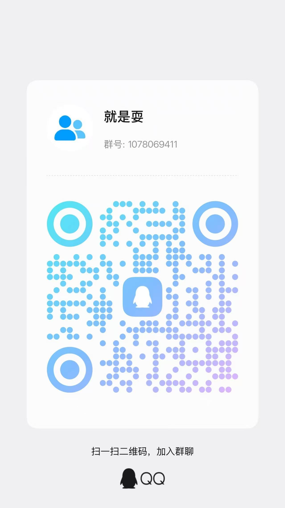

# DiPlay API 17 兼容性移植

本仓库是基于 [shihabal3amri/DiPlay](https://github.com/shihabal3amri/DiPlay) 的 Android API 17 有线和无线 CarPlay 移植，项目代码遵循 GPL-3.0。公开源码和版本 APK 发布在 GitHub Releases。

我用自己的 2018 款比亚迪宋 DM 做了多轮实车排查和适配，从 USB 授权和自动连接一路做到车机音频、方向盘按键和外置蓝牙。最近又分五轮改进了视频接收、硬解输出和触控，并把这套改进移植到有线版。 [0.44.51 详细更新](#04451-有线版详细更新) · [有线和无线的适配工作](#这个移植做了哪些工作)

## 开机自动连接，无需 VPN 授权

**有线和无线版都通过应用内的通信链路运行 CarPlay，车机重启后也无需确认 Android 系统 VPN 授权。**

- **有线插线即连。** 开启自动连接并完成首次授权后，车机开机即可检测 iPhone，插上数据线就自动进入投屏。
- **无线上车自动连接。** 首次配对并成功投屏后，保持适配器插着、iPhone 的蓝牙和 Wi-Fi 开启，车机开机就会自动尝试连接。

初次使用请按系统提示完成 USB 访问授权和 iPhone 端确认。无线版在支持 Wi-Fi Direct 的 MX9A0 车机上默认使用该模式。请关闭车机系统热点，车机移动数据可以保持开启。

## 下载 DiPlay

| 版本 | 下载 | 连接与安装 |
| --- | --- | --- |
| **有线 CarPlay 0.44.52** | [**下载有线 APK**](https://github.com/hange3514/DiPlay-API17/releases/download/v0.44.52/DiPlay_API17_0.44.52.apk) | USB 数据线连接 iPhone，支持最高 60 FPS 配置与双指触控转发。[版本说明](https://github.com/hange3514/DiPlay-API17/releases/tag/v0.44.52) |
| **无线 CarPlay 0.1.117** | [**下载无线 APK**](https://github.com/hange3514/DiPlay-API17/releases/download/wireless-v0.1.117/DiPlay_API17_0.1.117-auto-evidence.apk) | 实车使用绿联 CM591（`10D7:B012`），iPhone 自动加入车机的 Wi-Fi Direct 局域网。默认 20 FPS，可调至 60 FPS。[版本说明](https://github.com/hange3514/DiPlay-API17/releases/tag/wireless-v0.1.117) |

### 外拨回铃音测试版

- **有线 0.44.61** 增加约 48 毫秒的通话和提示音预缓冲，减少回铃开头断续和重复切换车机音源。[下载 APK 与更新说明](https://github.com/hange3514/DiPlay-API17/releases/tag/v0.44.61-call-ringback-test)
- **无线 0.1.126** 为外拨回铃和间隔较长的提示音调整缓冲恢复，同时保留接通后语音和正常媒体播放的处理路径。[下载 APK 与更新说明](https://github.com/hange3514/DiPlay-API17/releases/tag/wireless-v0.1.126-call-ringback-test)

有线和无线分别通过 532 项和 353 项本地回归测试及 API 17 签名校验。回铃改善效果待实车确认。

### 多手机切换测试版

- **有线 0.44.60** 改进快速拔插切换，按本次 USB 授权请求和当前设备确认连接，避免旧手机的授权或画面回调影响下一台。[下载与更新说明](https://github.com/hange3514/DiPlay-API17/releases/tag/v0.44.60-phone-switch-test)
- **无线 0.1.125** 优先连接上次成功投屏的 iPhone，确认失败后继续尝试其他已配对手机。换手机时核对投屏身份，并妥善处理旧会话结束和超时事件。[下载与更新说明](https://github.com/hange3514/DiPlay-API17/releases/tag/wireless-v0.1.125-phone-selection-test)

两份测试版均通过 API 17 APK 签名校验和本地回归测试，分别通过 523 项和 348 项。多手机切换仍待实车验证。

**反馈只填问题。** 两版都会自动把可读取的原厂车型代码、固件版本、ALSA 声卡与采集路径、通话诊断和方向盘事件放进同一份报告。停车复现问题后，在车机里写一句现象并提交即可。 [反馈与隐私](docs/COMPATIBILITY_TESTING.md)

## 适配交流

**QQ群「就是耍」 · `1078069411`**。用 QQ 扫下方二维码，或搜索群号加入。

欢迎其他车型用户在群里交流。遇到通话无声或方向盘按键异常，可在车机复现后提交问题描述。我有时间会根据收到的诊断排查适配。

## 实测车型

有线和无线版目前都只在下图这台 **2018 款比亚迪宋 DM** 上实测。车机为 Freescale MX9A0、Android 4.2.2 / API 17，固件 `V4.2.2.30.170830`，屏幕分辨率 1024 × 600。手机为 iPhone 15 Pro Max，系统为 iOS 26.2.1。无线版实测使用绿联 CM591，CM390 代码参考上游项目，尚未实车测试。

## 更正与致歉

我此前把自己的车辆年款误写为 2017 款。经重新确认，实际测试车辆是 **2018 款比亚迪宋 DM**。此前错误说明可能误导读者，我为此郑重致歉，相关车型信息现已同步更正。

## 0.44.51 有线版详细更新

这一版把无线 0.1.105–0.1.109 对画面和触控的改动整合到有线版。**投屏保持 1024 × 600，默认请求 60 FPS**。在 CarPlay 画面按返回键，打开控制面板的「画面帧率」，可选 15、20、30、40、50 或 60 FPS。保存后，下次连接会使用所选帧率。

### 硬件解码、画面节奏和积压恢复

- **适配老车机的 H.264 硬解。** 在 MX9A0 上优先尝试 Freescale 硬件解码器，初始化失败时回到系统默认的 AVC 解码器。适配 Android 4.2.2 的旧版 MediaCodec 接口，并处理解码输入缓冲区不足的情况。
- **让连续画面按接近原始节奏输出。** 用 iPhone 的帧时间戳和本地收帧时间判断短时抖动，提前到达的画面最多等待 10 毫秒再显示。首帧和已经迟到的帧尽快输出，解码积压时缩短等待，减少动画一顿一冲的感觉。
- **卡过一次后尽快追上实时画面。** 限制解码前的排队和帧龄，积压严重时从可用的 H.264 关键帧恢复，必要时请求 iPhone 刷新画面。车机画面销毁或重新出现时，旧画面的队列会单独清理，避免冲掉新画面的第一帧。

### 车机实测帧率对比

- 「画面帧率 → 自动对比」可选基础组 **15 / 20 / 30 FPS** 或高帧率组 **30 / 40 / 50 / 60 FPS**。每档使用独立的 CarPlay 连接，按提示在同一个列表持续滑动，采样约 15 秒。测试结束后可以应用推荐值，或用原来的设置重新连接。
- 按 iPhone 来帧数、车机解码后提交屏幕的帧数、画面长间隔和丢帧情况给出建议。有效画面变化太少时会提示样本不足。诊断还区分网络收帧抖动、解码积压和输出节奏，便于判断卡顿出在哪一段。这些统计测量的是视频链路，面板实际刷新率取决于车机硬件。

### 双指缩放和触控稳定性

- 车机采集两个触点的坐标与按下、移动、抬起状态，经 CarPlay 的 HID 通道送给 iPhone，高德地图等支持多点手势的应用就能双指捏合缩放。
- 分别跟踪两根手指，抬起其中一根时保留另一根。快速滑动时合并积压的移动事件，优先送出按下和抬起。退出投屏、切到其他界面或车机画面重建时会清理旧触点，减少误触和手指松开后地图继续移动的情况。

**验证进度。** 60 FPS 动画和高德地图双指缩放已在这台车的无线 **0.1.109** 上实测通过。两种连接方式当前的下载版本和验证范围见各自的发布说明。 [有线 0.44.52](docs/RELEASE_0.44.52.md) · [无线 0.1.117](docs/WIRELESS_0.1.117.md)

## 这个移植做了哪些工作

### 有线连接与原车功能

- **把网络协议栈搬进 APK。** 在 Android 4.2.2 上接入 lwIP，让应用直接在 USB NCM 链路处理 IPv6、TCP 和 UDP。CarPlay 会话跑在应用自己的套接字上，解决重启车机后重复确认 VPN 授权的问题。
- **逐段处理开机和插线连接。** 把能提前做的初始化放到启动阶段，支持开机监测和插线自动连接。iPhone 切换 CarPlay 模式后可能换一个 USB 设备对象，授权等待会重新查找当前设备。连接流程与系统 USB 授权界面也做了协调，减轻提示框被遮住或应用一直等待旧设备的问题。 [有线 0.44.49 说明](docs/RELEASE_0.44.49.md)
- **排查通话无声，适配原车音频。** 在实测车机上通过 ALSA 直接采集麦克风，让通话期间车载麦克风和扬声器同时工作。应用会探测可用的采集节点，通话上行加入滤波以减少低频轰鸣和语音间隙底噪。媒体和导航分别使用对应的车机音量通道。 [通话音频修复](docs/RELEASE_0.40.0.md) · [ALSA 路径适配](docs/RELEASE_0.42.0_AUTO_ALSA.md)
- **解决方向盘切歌间歇失效。** 重新梳理媒体键接收器的注册、系统接收权回读、实际收键和转发。显示首帧后申请接收权，停止或断线后交还系统。上一曲和下一曲在 0.44.50 上实车验证。 [有线 0.44.50 说明](docs/RELEASE_0.44.50.md)
- **整理日常用车界面。** 加入启动过渡、按阶段提示的连接进度和投屏控制面板。投屏后按返回键即可查看控制面板，断连时清空上一帧画面。

### 无线连接与外置硬件

- **接入绿联 CM591 外置 USB 蓝牙。** 基于开源 USB 蓝牙栈适配这台车机，处理适配器发现、iPhone 配对和后续 iAP2 握手。蓝牙负责配对并引导手机加入车机网络，画面、声音和触控走 Wi-Fi。 [无线版与上游来源](docs/WIRELESS_0.1.104.md)
- **从普通系统热点改成 Wi-Fi Direct。** 实车排查发现，车载移动网络恢复时，普通热点会因 NAT 转发失败而被系统关闭。无线 0.1.104 在支持的 MX9A0 上默认用 Wi-Fi Direct 建本地局域网，避开这条故障路径，移动数据可以继续开启。
- **按首次配对和日常上车分别处理。** 首次在车机授权 USB 并在 iPhone 确认配对后，后续开机使用保存的配对信息自动尝试连接。保留连接、音频和视频诊断，便于按版本和设备复现实车问题。 [历次版本记录](CHANGELOG.md)

## 隐私与发布内容

通过应用主动提交的反馈会发送至维护者的私人服务器。两版都自动附带可读取的车机身份、声卡、通话和按键证据。无线版可选择附带短时麦克风测试录音。 [兼容性报告说明](docs/COMPATIBILITY_TESTING.md)

公开源码不包含私人服务器令牌、签名密钥或离线 MFi 身份文件。公开 APK 按维护者决定包含运行所需的上游来源附件身份；来源说明见 [`docs/AUTH_PROVENANCE.md`](docs/AUTH_PROVENANCE.md)。这不代表 Apple 认证或额外分发授权，也不保证未来 iOS 版本或其他车型可用。

## 构建

- 有线源码在 [`v0.44.52` 标签的 `legacy/`](https://github.com/hange3514/DiPlay-API17/tree/v0.44.52/legacy)，参见[有线构建说明](docs/BUILD.md)。
- 无线源码在 [`wireless-v0.1.117` 标签的 `legacy-wireless/`](https://github.com/hange3514/DiPlay-API17/tree/wireless-v0.1.117/legacy-wireless)，参见[无线构建说明](https://github.com/hange3514/DiPlay-API17/blob/wireless-v0.1.117/legacy-wireless/BUILD.md)。
- API 17 编译所需工具链及 Android SDK 组件需自行准备。自签名 APK 要和车机上已有版本签名一致才能覆盖安装。 [历史版本](https://github.com/hange3514/DiPlay-API17/releases)
